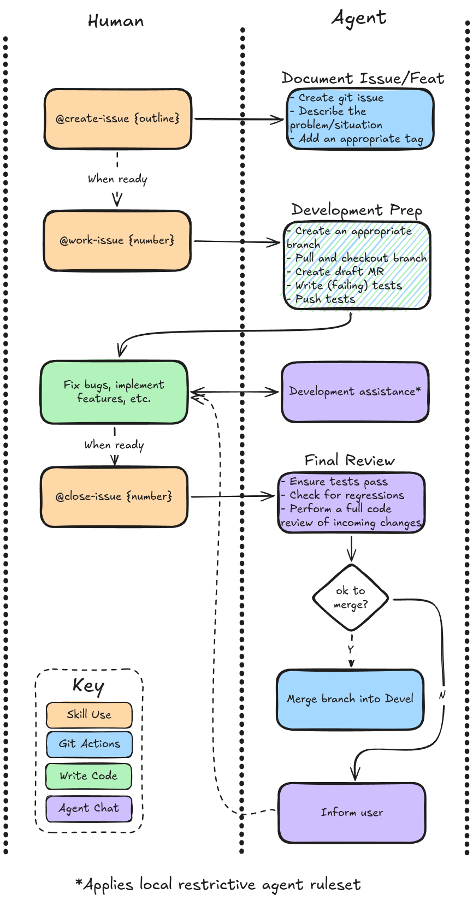

# Agent Skills

This repository exists to keep track of agent skills. This serves the purposes of historical tracking and portability.

## Development skills

There are 3 existing dev skills:

- create-issue
- work-issue
- close-issue

Each skill offloads much of the admin work associated with development work, however their use-cases are best summarised in image form:

